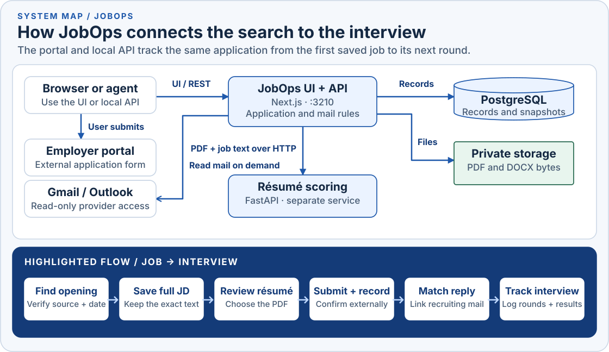
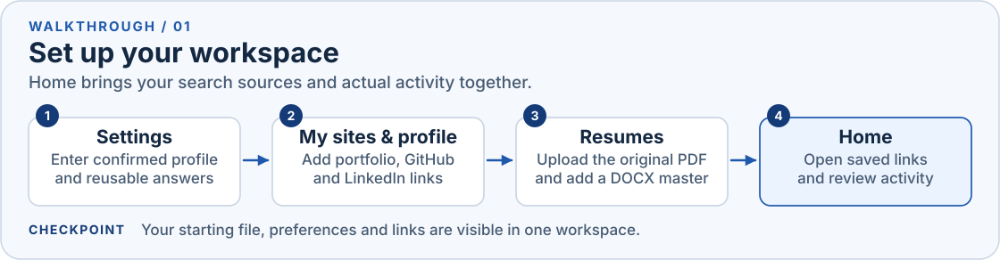
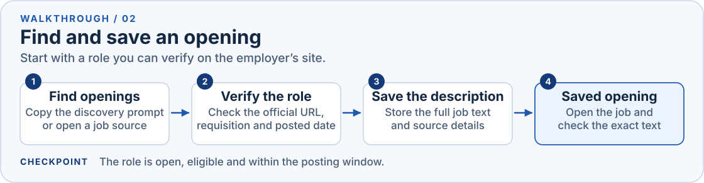
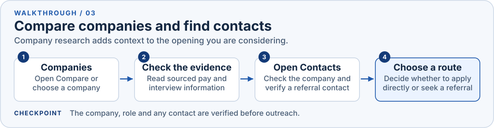
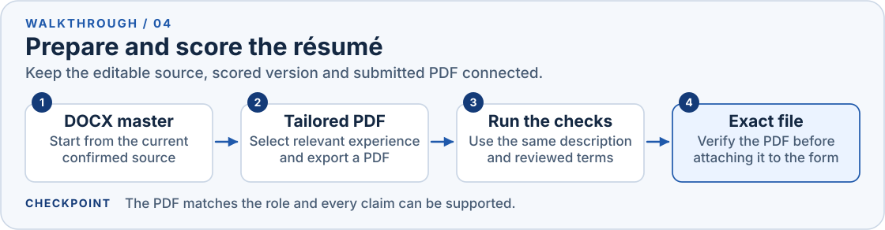
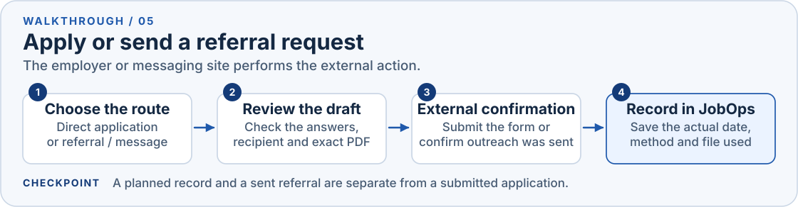
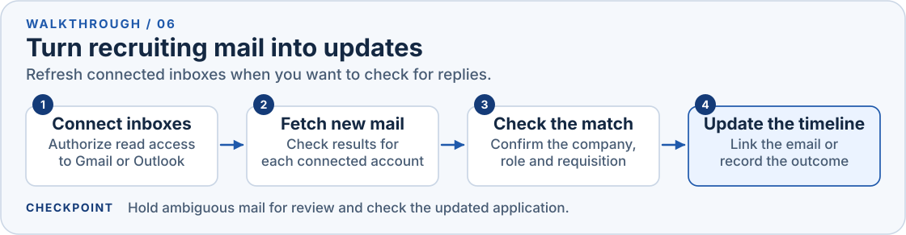
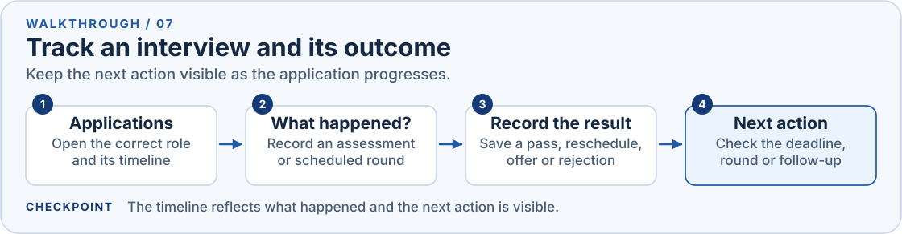
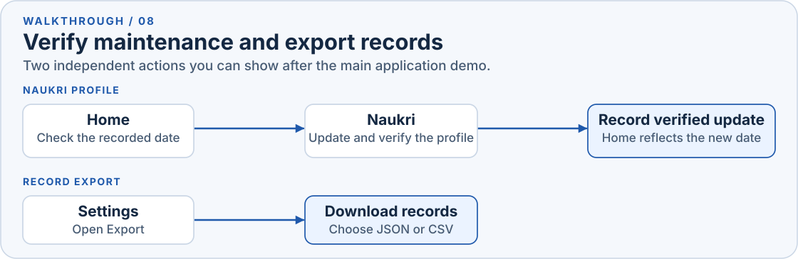
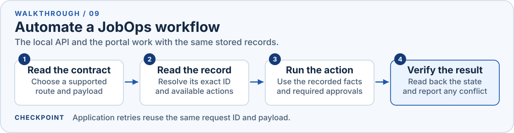

# JobOps

JobOps is a personal job-search workspace for India. Use it to find and save an opening, prepare the right résumé, record an application, and track replies and interview rounds. The walkthrough below follows one real opening from start to finish.

## Start JobOps

From the repository root, with Docker running:

```sh
# First setup only. Preserve an existing jobops/.env.
cp -n jobops/.env.example jobops/.env
docker compose up -d --build
```

Open [JobOps](http://127.0.0.1:3210). For the walkthrough, bring one live employer link and a résumé PDF. Use the [operator reference](jobops/docs/operator-reference.md) for Docker, inbox setup, backups, and deployment details.

## How it fits together



Start with the highlighted box. JobOps keeps the exact job description and résumé version together with the application and its timeline. You submit on the employer's site, then use JobOps to record what happened and follow the next action.

## Walk through one opening

### 1. Set up your workspace



1. In **Settings**, add your candidate details, job preferences and **Standard answers**. Use confirmed facts you can reuse in forms.
2. In **My sites & profile**, save your LinkedIn, GitHub or portfolio links. In **Resumes**, add your original PDF. Ask your assistant to import an editable DOCX master if you need one. [Master setup](jobops/docs/operator-reference.md#resume-storage-and-backup)
3. Return to **Home** to show the saved links, job sources and activity from your records.

### 2. Find and save a job



1. On **Home**, choose **Find openings**. Copy the editable discovery prompt into your assistant, or open a job source such as LinkedIn India, Naukri, Instahyre, Cutshort or Hirist.
2. Verify the role on the employer's site. Check the location, live apply link, requisition and sourced publication date. Use the [current freshness and eligibility rules](AGENTS.md#product-scope) before preparing the application.
3. Choose **Save a job description** and store the full description and original link. Use **Import jobs** to preview and import JSON or CSV in batches. Open the saved job and check the text before moving on.

### 3. Compare the company and find a contact



1. In **Companies**, open **Compare** or choose the company directly. Use its **Compensation** and **Interviews** tabs to show the evidence behind each fact.
2. Check its careers link and **Timeline** for the relevant role and any prior activity. If a referral makes sense, open **Contacts** and verify the person and employer's referral process.

### 4. Prepare and score the résumé



1. Start from the current DOCX master. Select relevant, confirmed experience and export a text-based PDF. Keep new drafts locally while you compare them.
2. For a stored PDF, use **Score against a job** with the saved opening and reviewed terms. **Score a description** runs checks against pasted text without saving the result in JobOps. For a local draft, run the checks with your assistant and the scoring tools.
3. Compare the evidence and gaps for the exact job and version. These scores are tool diagnostics. Verify the PDF you intend to attach. After submitting, save the exact used PDF in **Resumes** with its label and change notes if it is missing.

### 5. Apply or send a referral request



1. On the saved opening, choose **Direct application** or **Referral / message**. Review the completed form and exact PDF before submitting on the employer's site. Approve any outreach before sending it.
2. After confirmation, use **Record what happened** to save the actual date, method and exact PDF used. If you are still preparing, select **I am preparing this**. A sent referral request has its own record.

### 6. Check mail and match the reply



1. In **Mail**, open **Inboxes** and connect Gmail or Outlook with read-only access. See the [inbox setup instructions](jobops/docs/operator-reference.md#inbox-read-only-setup) if credentials are missing.
2. Choose **Fetch new mail** and check each inbox's result. Search a company if you need to recover an earlier message.
3. Match the reply to the exact role. Check whether JobOps already applied an outcome. Link a confirmed match or record the outcome from the email. Leave ambiguous mail open for review.

### 7. Track the interview and the next action



1. In **Applications**, expand the correct role. Under **What happened?**, record an assessment or scheduled round with its deadline or date and time.
2. Reopen the same record when the round is rescheduled or you get a result. Record what happened and check the updated timeline and next action.

## Show the supporting workflows

### 8. Check Naukri maintenance and export records



1. On **Home**, check the Naukri card. If you refresh the profile on Naukri, verify the result there before [recording the update](jobops/docs/api/automation.md#naukri-and-protected-reads).
2. For a portable copy of your records, open **Settings → Export**. Use the [backup procedure](jobops/docs/operator-reference.md#resume-storage-and-backup) when you need the stored files and database together.

### 9. Show what an agent can automate



1. Give your assistant the [API automation guide](jobops/docs/api/automation.md). It lists supported company, application, résumé, mail, scoring and Naukri actions and their access requirements.
2. For a safe demo, ask it to look up the application and list its available transitions. Compare its result with the open timeline. Use writes to record real events and read back the result.

## Installed assistant skills

| Skill | Location | Use |
| --- | --- | --- |
| `job-apply` | [Shared playbook](.claude/skills/job-apply/SKILL.md), also available under `.agents/skills/` | Work on one opening, prepare the résumé, check mail, and record the outcome. |
| `resume-ats-optimizer` | User-level `~/.agents/skills/resume-ats-optimizer/SKILL.md` · [source](https://github.com/paramchoudhary/ResumeSkills/tree/main/skills/resume-ats-optimizer) | Review résumé formatting and keyword coverage against a job description. |

Say **Apply for this job** and provide the link, or invoke `$job-apply` in Codex or `/job-apply` in Claude Code. Keep this inventory current when project-related skills change. For deeper details, see the [operator reference](jobops/docs/operator-reference.md), [API guide](jobops/docs/api/automation.md) or [scoring service](services/resume-scoring/README.md).
