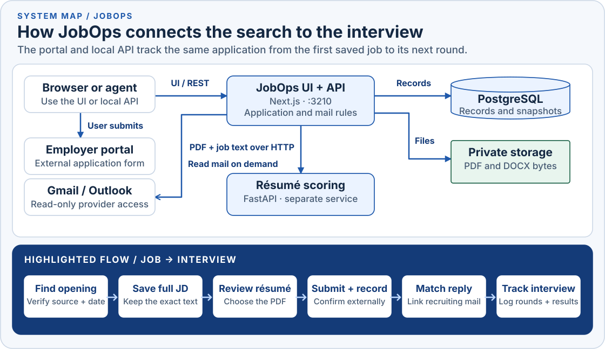
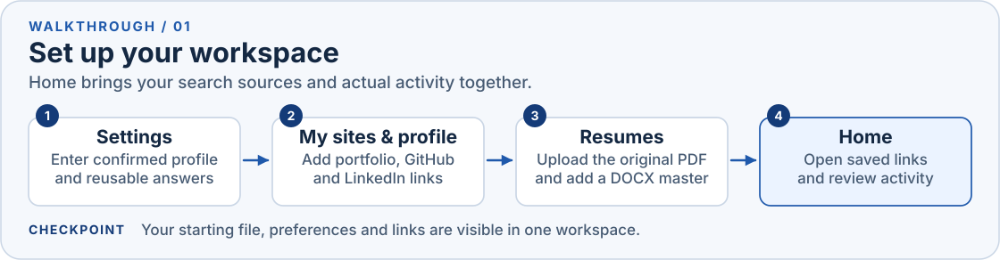
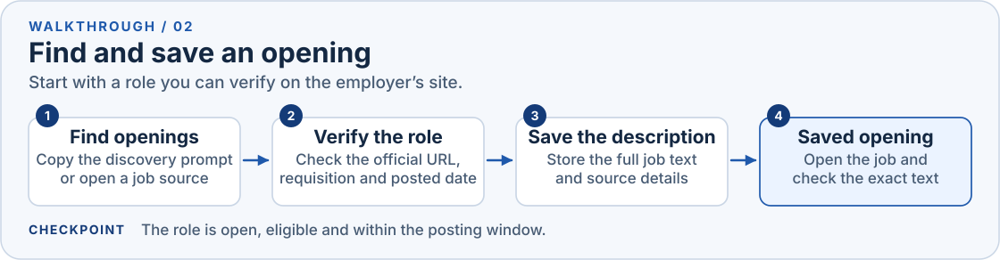
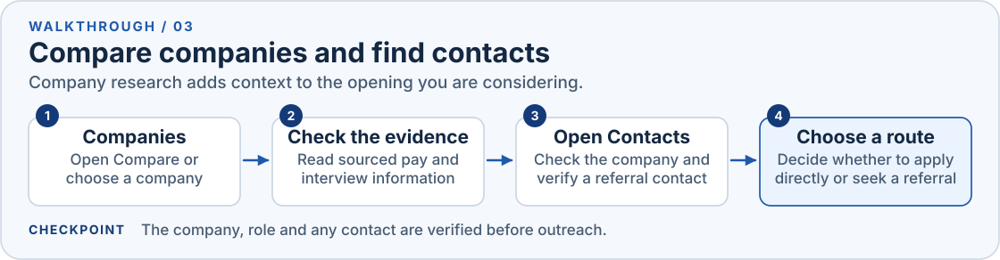
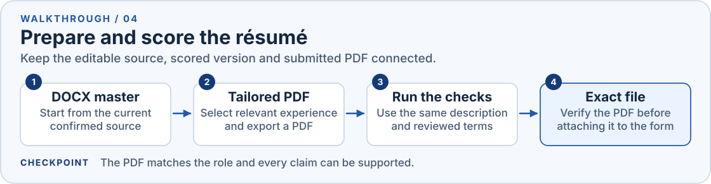
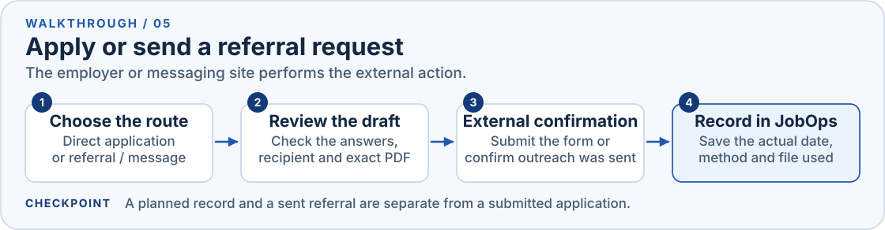
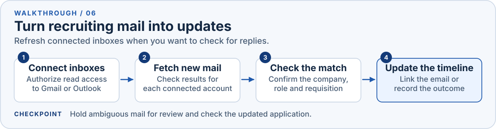
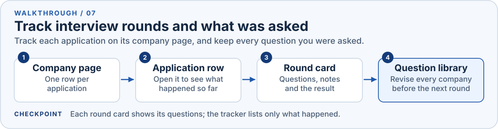
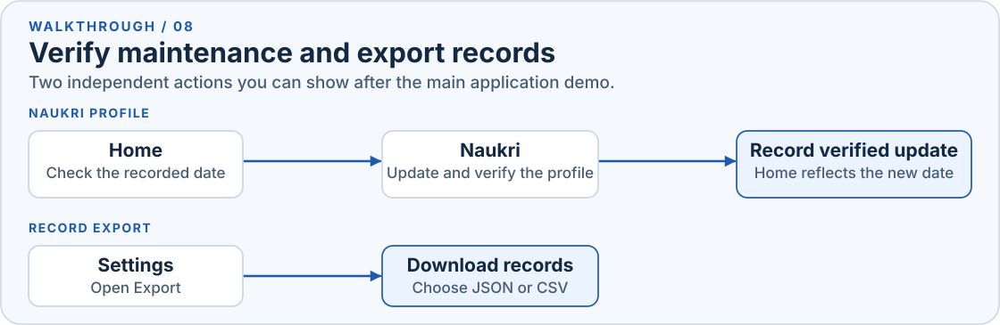
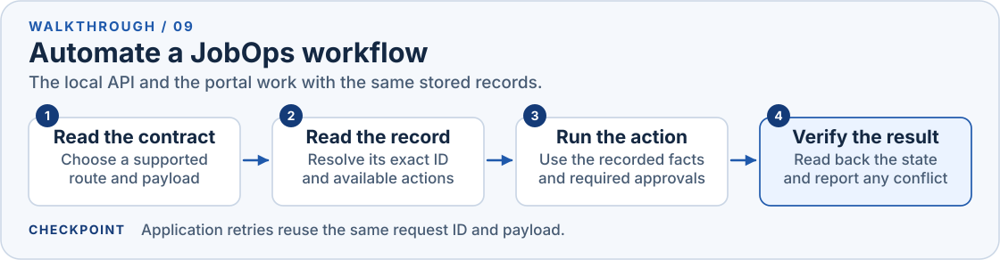

# JobOps

JobOps is a personal job-search workspace for India. Use it to find and save an opening, prepare the right résumé, record an application, and track replies and interview rounds. The walkthrough below follows one real opening from start to finish.

## Start JobOps

From the repository root, with Docker running:

```sh
# First setup only. Preserve an existing jobops/.env.
cp -n jobops/.env.example jobops/.env
docker compose up -d --build
```

Open [JobOps](http://127.0.0.1:3210). For the walkthrough, bring one live employer link and a résumé PDF. Use the [operator reference](jobops/docs/operator-reference.md) for Docker, inbox setup, backups, and deployment details.

## How it fits together



Start with the highlighted box. JobOps keeps the exact job description and résumé version together with the application and its timeline. You submit on the employer's site, then use JobOps to record what happened and follow the next action.

## Walk through one opening

### 1. Set up your workspace



1. In **Settings**, add your candidate details, job preferences and **Standard answers**. Use confirmed facts you can reuse in forms.
2. In **My sites & profile**, save your LinkedIn, GitHub or portfolio links. In **Resumes**, add your original PDF. Ask your assistant to import an editable DOCX master if you need one. [Master setup](jobops/docs/operator-reference.md#resume-storage-and-backup)
3. Return to **Home** to show the saved links, job sources and activity from your records.

### 2. Find and save a job



1. On **Home**, choose **Find openings**. Copy the editable discovery prompt into your assistant, or open a job source such as LinkedIn India, Naukri, Instahyre, Cutshort or Hirist.
2. Verify the role on the employer's site. Check the location, live apply link, requisition and sourced publication date. Use the [current freshness and eligibility rules](AGENTS.md#product-scope) before preparing the application.
3. Choose **Save a job description** and store the full description and original link. Use **Import jobs** to preview and import JSON or CSV in batches. Open the saved job and check the text before moving on.

### 3. Compare the company and find a contact



1. In **Companies**, open **Compare** or choose the company directly. Use its **Compensation** and **Interview loop** tabs to show the evidence behind each fact.
2. Check its careers link (the **⋯** menu, **Open careers site**) and **Applications** for the relevant role and any prior activity. If a referral makes sense, open **Contacts** and verify the person and employer's referral process.

### 4. Prepare and score the résumé



1. Start from the current DOCX master. Select relevant, confirmed experience and export a text-based PDF. Keep new drafts locally while you compare them.
   Consider the complete background and separately labelled project evidence, including AI-assisted work. An older tailored file does not define your specialty; project experience does not establish professional years in a skill. Discovery, résumé, application and outreach prompts, and the recorded revision brief carry the same source/provenance rules.
2. For a stored PDF, use **Score against a job** with the saved opening and reviewed terms. **Score a description** runs checks against pasted text without saving the result in JobOps. For a local draft, run the checks with your assistant and the scoring tools.
3. Compare the evidence and gaps for the exact job and version. These scores are tool diagnostics. Verify the PDF you intend to attach. After submitting, save the exact used PDF in **Resumes** with its label and change notes if it is missing.

### 5. Apply or send a referral request



1. On the saved opening, choose **Direct application** or **Referral / message**. Review the completed form and exact PDF before submitting on the employer's site. Approve any outreach before sending it.
2. After confirmation, use **Record what happened** to save the actual date, method and exact PDF used. If you are still preparing, select **I am preparing this**. A sent referral request has its own record.

### 6. Check mail and match the reply



1. In **Mail**, open **Inboxes** and connect Gmail or Outlook with read-only access. See the [inbox setup instructions](jobops/docs/operator-reference.md#inbox-read-only-setup) if credentials are missing.
2. Choose **Fetch new mail** and check each inbox's result. Search a company if you need to recover an earlier message.
3. Match the reply to the exact role. Check whether JobOps already applied an outcome. Each new email asks one question, **This email is about**: one of the company's roles (the role the email names comes first), **Nothing, just info**, **A new job to consider** or **A different company…**. A single button then says what it will save (for example **Add to CS ARIA** or **Save round scheduled for …**) and a line under it says where it will show. Use **Different update** for another outcome. Leave ambiguous mail open for review. The same bar and saves run on Mail, the company page and the phone, and agents use the same actions through the API, so every page stays in sync.
4. **Coming up** at the top of All job mail lists only dated steps for the next 7 days (rounds, deadlines, follow-ups), one row each. With more than three roles, a company's role filters fold into one **Role** menu. The company list stays in view while the mail scrolls.

### 7. Track interview rounds and what was asked



1. Open the company from **Companies** or any application link (they all land on the company page). The header is the company name and a four-stat strip; its **⋯** menu holds **Open careers site**, **Add previous job** and **Mail search settings**. The first tab, **Applications**, has one card per application: role first, with a progress bar and an "N new" badge for unread mail. The tracker shows only what happened: **Applied**, **Acknowledged**, **Interview scheduled**, **Round 1 · DSA** and so on, then **Offer** or **Rejected**. Companies that are not in your list get a minimal page with a banner.
2. Open the card. It leads with a current-step box: record a booked round's result or a reschedule there, and record an assessment or scheduled round with its date and time under **+ Add step**. A one-line note box adds a free-text note to the history. The history filters between **All**, **Stages** and **Mail**, and a dot marks what is new. Mail filed under the wrong application is fixed with the email's link and unlink actions.
3. A details sidebar (a facts row with a **Details** toggle on narrow screens) shows the opening and requisition, when you applied, the **Résumé used** and where it stands, with Notes and follow-ups. The history lists every email, recorded step and round. Every email opens in a reading popup; the previews leave out raw links.
4. In the round card, choose **Questions**, then **Add a question**. Write what they asked, how you answered and what the interviewer said in Markdown, with code blocks and tables, and mark how it went. Save with **Save question** or ⌘S. Keep longer prep notes in the application's **Notes** or the round's **Round notes**.
5. Before the next round, open **Question library** from Applications to search and sort every question across companies. An agent can add a review to a question through the [interview questions API](jobops/docs/api/interview-questions.md); it shows with its source and never replaces your answer.

## Show the supporting workflows

### 8. Check Naukri maintenance and export records



1. On **Home**, check the Naukri card. If you refresh the profile on Naukri, verify the result there before [recording the update](jobops/docs/api/automation.md#naukri-and-protected-reads).
2. For a portable copy of your records, open **Settings → Export**. Use the [backup procedure](jobops/docs/operator-reference.md#resume-storage-and-backup) when you need the stored files and database together.

### 9. Show what an agent can automate



1. Give your assistant the [API automation guide](jobops/docs/api/automation.md). It lists supported company, application, résumé, mail, scoring and Naukri actions and their access requirements.
2. For a safe demo, ask it to look up the application and list its available transitions. Compare its result with the open timeline. Use writes to record real events and read back the result.

## Installed assistant skills

| Skill | Location | Use |
| --- | --- | --- |
| `job-apply` | [Shared playbook](.claude/skills/job-apply/SKILL.md), also available under `.agents/skills/` | Work on one opening, prepare the résumé, check mail, record the outcome and the interview questions. |
| `resume-ats-optimizer` | User-level `~/.agents/skills/resume-ats-optimizer/SKILL.md` · [source](https://github.com/paramchoudhary/ResumeSkills/tree/main/skills/resume-ats-optimizer) | Review résumé formatting and keyword coverage against a job description. |

Say **Apply for this job** and provide the link, or invoke `$job-apply` in Codex or `/job-apply` in Claude Code. Keep this inventory current when project-related skills change. For deeper details, see the [operator reference](jobops/docs/operator-reference.md), [API guide](jobops/docs/api/automation.md) or [scoring service](services/resume-scoring/README.md).
