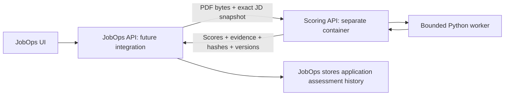

# Resume compatibility service

An independent Python service for assessing one exact resume against one saved job description.
It has its own Docker image, dependency lock, API, extraction/scoring code and tests. It imports
nothing from Next.js, has no database connection, mounts no uploads, and makes no external API or
LLM calls. The caller sends document contents and owns any saved results.

## Stack and boundaries

- **Python 3.13** for document processing and a future NLP provider ecosystem.
- **FastAPI + Pydantic 2** for a typed, validated HTTP contract and generated OpenAPI.
- **pdfplumber/pdfminer.six** for text and word coordinates from text-based PDFs. No rendering or OCR
  is required for the current user-provided PDFs. Scans remain unassessable.
- **AnyIO subprocess workers** isolate CPU-bound extraction from the API event loop. Two assessments
  may run concurrently; each has a 20-second deadline. Cancellation terminates the worker process.
- **uv + uv.lock** lock production and test dependencies; Docker uses `--frozen`.
- **pytest + ReportLab synthetic fixtures + Ruff** verify behavior without personal resumes or data.

There is intentionally no Redis, Celery or second database in this first synchronous service.
Persistent asynchronous work can later add a service-owned queue/worker and database, without access
to the JobOps database. A separately deployed service does not need to duplicate application history.



**Current delivery:** the standalone scoring service and Compose integration. JobOps does not yet
call it or save its structured response. Application/resume UI integration must first be previewed
in the gallery. Existing manual assessments and submitted resume references are unchanged.

## Run in Docker

From the repository root or `jobops/`:

```sh
docker compose up -d --build resume-scoring
docker compose ps resume-scoring
```

Or run it independently, without JobOps/PostgreSQL:

```sh
docker compose -f services/resume-scoring/compose.yaml up -d --build
```

Choose one invocation; both publish the same loopback port. When included in JobOps, the internal
address is `http://resume-scoring:8000`. Local terminal clients use `http://127.0.0.1:3212`.
OpenAPI is at `/openapi.json`; schema documentation is at `/docs` and `/redoc`.
This is a server-to-server API; browser requests carrying Origin are rejected. A future JobOps UI
calls its own protected server endpoints, never this service directly.

Loopback and trusted Docker-network access require no key by default, matching local-only usage.
For authenticated service access set `SCORING_API_KEY` in the Compose environment and send
`X-API-Key` on all requests except `/health`. Never publish this service publicly without an
authenticated TLS gateway. No secrets belong in source control.

The production container runs as an unprivileged user with a read-only filesystem and bounded
memory/CPU. Temporary multipart spooling uses a 64 MiB tmpfs and uploaded files are closed after each
request. Document text, filenames and assessment bodies are not logged. Responses are not cached.

## API

| Endpoint | Contract |
| --- | --- |
| `GET /health` | Liveness and engine version; no authentication |
| `GET /v1/scoring-methods` | Score IDs, formulas, weights, versions and coordinate conventions |
| `GET /v1/metadata-schema` | JSON Schema for the PDF endpoint's `metadata` form field |
| `POST /v1/assessments` | JSON: resume text, JD, optional reviewed requirements and reference IDs |
| `POST /v1/assessments/pdf` | Multipart: `resume` PDF and `metadata` JSON string |

Synthetic, runnable text example:

```sh
curl --fail-with-body http://127.0.0.1:3212/v1/assessments \
  -H 'Content-Type: application/json' --data-binary @- <<'JSON'
{
  "resume_text": "Built Python and Docker services.",
  "job_description": "Required: Python and SQL. Preferred: Docker.",
  "resume_version_id": "synthetic-version-a",
  "job_snapshot_id": "synthetic-snapshot-a",
  "requirements": [
    {"term":"Python","importance":"required","jd_quote":"Required: Python and SQL."},
    {"term":"SQL","importance":"required","jd_quote":"Required: Python and SQL."},
    {"term":"Docker","importance":"preferred","jd_quote":"Preferred: Docker."}
  ]
}
JSON
```

For PDF input, save the same metadata without `resume_text` to a private `metadata.json`, then:

```sh
curl --fail-with-body http://127.0.0.1:3212/v1/assessments/pdf \
  -F 'resume=@/absolute/path/to/resume.pdf;type=application/pdf' \
  -F 'metadata=<metadata.json'
```

References (`resume_version_id`, `job_snapshot_id`, `application_id`) are opaque caller labels, not
authoritative database lookups. The JobOps adapter must verify that the application owns the job and
submitted resume, send the exact saved PDF and JD snapshot, and validate returned hashes before saving.
Never silently select a family's newest resume or a job's newest description for an old application.

Each response contains a content-derived `assessment_id`, source SHA-256 hashes, engine version,
scores, per-requirement findings, extracted text, page dimensions and warnings. Identical inputs,
reference IDs and method version return identical results. The service stores nothing, so there is no
`GET /assessments/{id}` history endpoint. The caller may deduplicate/store by the returned ID.

Highlights use **1-based pages**, **PDF points**, and a **top-left origin**. Scale boxes using the
returned page width/height for a PDF viewer. Offsets are **Unicode code points**, end-exclusive, into
the returned `resume_text` or submitted JD. JavaScript consumers must use `Array.from(text)` for
offset slicing when text contains supplementary characters; raw JS UTF-16 string indexes differ.
At most 20 evidence occurrences are returned per term. PDF words may form multiple boxes for one
phrase. Text-only requests cannot provide PDF coordinates.

Limits: 10 MiB PDF, 12 pages, 100,000 extracted text characters, 100 reviewed requirements and
11 MiB total HTTP request (also enforced for chunked requests). Errors: 401 missing/wrong configured
key, 403 browser access, 413 size limit, 422 invalid input/unreadable PDF, 429 capacity busy with
`Retry-After`, 504 processing deadline, 503 worker unavailable. Validation errors omit private inputs.

## What the scores mean

The installed [`resume-ats-optimizer`](https://github.com/Paramchoudhary/ResumeSkills/tree/main/skills/resume-ats-optimizer)
skill informed the baseline keyword-coverage rubric. The repository [skill inventory](../../README.md#installed-assistant-skills)
records its source, installed location and installation command. The service runs independently of
that assistant installation and never executes the skill at runtime. Its
keyword-match formula is implemented as an explicit measure, not as a validated employer score.
There is no universal passing threshold, no prediction of interview chances, and no unsupported
claim that a percentage of resumes is automatically rejected.

- **Keyword coverage:** 100 × distinct mentioned criteria / distinct criteria.
- **Required coverage:** the same formula, restricted to caller-labelled required criteria.
- **Preferred coverage:** restricted to preferred criteria.
- **Weighted coverage:** required criteria weight 3; preferred/unspecified weight 1. These are
  disclosed product weights, not a learned or employer-calibrated ranking.

Literal terms and declared aliases can match. Repeating a term never raises a score. Java does not
match JavaScript; SQL does not match NoSQL. Mentioned means only that the text contains the term.
Negated/learning-context mentions are marked unclear using a conservative heuristic and the affected
score is withheld. This heuristic is not a complete natural-language interpretation.

Omitting `requirements` produces finite vocabulary suggestions with unspecified importance and
`needs_review` status. They can include company background rather than requirements and cannot
represent all requirements. Supply reviewed terms, aliases, importance and verbatim JD quotes for
a deliberate rubric. Caller-defined aliases are caller assertions, not verified semantic equivalence.

Missing denominators, ambiguous evidence or incomplete PDF extraction produce **null**, not zero.
A blank/image-only page prevents scoring of the entire PDF until reviewed, even if other pages have
text. Text input does not establish PDF parseability. Visual layout, semantic experience evidence,
seniority, practical fit and overall employer ATS compatibility remain unscored.

## Verify in Docker

From the repository root:

```sh
docker build --target test -t jobops-resume-scoring-test services/resume-scoring
docker run --rm --network none jobops-resume-scoring-test
docker run --rm --network none jobops-resume-scoring-test uv run --frozen ruff check .
docker run --rm --network none jobops-resume-scoring-test uv run --frozen ruff format --check .
```

Tests exercise real subprocess execution and synthetic PDF extraction, exact highlights, version
identity, aliases, negation, unknown criteria, encryption/corruption, partial/oversized files, API
authentication, body limits, privacy-safe validation, timeout recovery and saturation.

Future scoring engines must expose their own method/version and evidence, preserve raw vendor
scales, and be evaluated on manually reviewed resume/JD pairs before being trusted. Any optional
LLM/vendor integration changes the current local-only/no-LLM behavior and is not enabled here.
